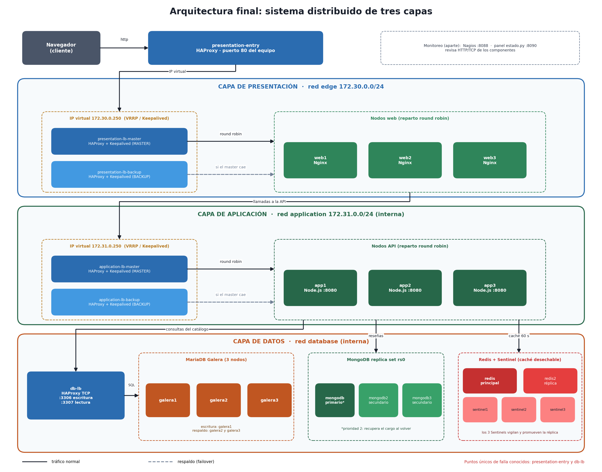

# Demostración de tienda distribuida de tres capas

La pila (*stack*) sirve una tienda estática a través de tres nodos de presentación Nginx. Su capa de aplicación en Node.js consulta un clúster de MariaDB Galera para obtener los diez productos más baratos, almacena en caché esa lista en Redis y guarda las reseñas de productos en MongoDB. Instancias de HAProxy distribuyen las solicitudes dentro de cada capa, y Keepalived proporciona una IP virtual (VIP) maestro/respaldo (*master/backup*) para cada par de HAProxy.

## Migración a plataforma (Parcial 3)

Este repositorio implementa el [plan de migración de plataforma](https://github.com/tuxtter/distributedsystems/blob/main/PLATFORM-MIGRATION-PLAN.md): K3s con un nodo en cada computadora del equipo (2 computadoras: 1 server + 1 agent), Terraform, FluxCD (GitOps), GitHub Actions, RabbitMQ con un servicio `worker`, OpenTelemetry + Grafana LGTM y Wazuh. Docker Compose se mantiene como entorno de desarrollo.

| Documento | Contenido |
|-----------|-----------|
| [docs/IMPLEMENTACION.md](docs/IMPLEMENTACION.md) | Documentación de la implementación, fase por fase |
| [docs/PLAN-ESTADO.md](docs/PLAN-ESTADO.md) | Cada punto del plan y el archivo que lo implementa |
| [docs/CLUSTER-EQUIPO.md](docs/CLUSTER-EQUIPO.md) | Armar el clúster en las 2 computadoras del equipo (WSL + Tailscale) o, como plan B, en una sola computadora con k3d |
| [docs/PRUEBAS.md](docs/PRUEBAS.md) | Cómo ejecutar las pruebas unitarias, de desempeño y de resiliencia, y **resultados medidos** |
| [docs/evidencias/](docs/evidencias/README.md) | Capturas y salidas reales de la ejecución (Compose, K3s, caos, pérdida de nodo) |
| [docs/runbooks/](docs/runbooks/) | Despliegue, rollback, pérdida de nodo, cola acumulada, incidente de seguridad, respaldos |

| Directorio | Qué contiene |
|------------|--------------|
| `infra/terraform/` | Módulos `network`, `storage`, `k3s-nodes`, `flux-bootstrap`; entornos `dev` y `prod` |
| `clusters/{dev,prod}/` | Puntos de entrada de Flux con el orden de dependencias |
| `deploy/base`, `deploy/overlays/{dev,prod}` | Web, API, worker (Kustomize) |
| `deploy/data`, `deploy/queues` | Galera + MaxScale, MongoDB, Redis + Sentinel, RabbitMQ (operadores) |
| `deploy/platform/` | Operadores, cert-manager, MetalLB, Kyverno, observabilidad, Wazuh, Chaos Mesh |
| `worker/`, `shared/`, `messaging/` | Consumidor de colas, código compartido, topología y esquemas de mensajes |
| `.github/workflows/` | `ci.yml`, `release.yml`, `terraform.yml` |
| `scripts/`, `pruebas/plataforma/` | Clúster local con k3d, secretos SOPS, pruebas de desempeño y caos |

Inicio rápido: `npm test` (pruebas unitarias), `./levantar.sh` (Compose) o `scripts/local-cluster.sh up` (K3s en una computadora: 1 server + 1 agent). Detalles en [docs/PRUEBAS.md](docs/PRUEBAS.md).

## Arquitectura

Las solicitudes de listas de productos consultan Redis en primer lugar; si ocurre un fallo de caché (*cache miss*), se consulta a MariaDB y luego se pobla Redis. Las solicitudes de reseñas utilizan MongoDB, usando MariaDB para verificar el producto antes de insertar la reseña. En esta configuración de Compose en un solo host, el puerto 80 del host es publicado por el contenedor maestro de presentación; la VIP de presentación no traslada el mapeo de puertos del host de Docker durante una conmutación por error (*failover*).

## Ejecución local

1. Copia `.env.example` a `.env` y reemplaza las contraseñas de ejemplo.
2. Inicia la pila con `docker compose up --build`.
3. Abre `http://localhost/` para la tienda, `http://localhost:8088/` para Nagios y `http://localhost:15672/` para la consola de RabbitMQ. Con `docker compose --profile observability up -d` y `OTEL_EXPORTER_OTLP_ENDPOINT=http://otel-lgtm:4318` en `.env`, Grafana queda en `http://localhost:3000/`.

El endpoint de productos es `http://localhost/api/products/cheapest`; devuelve un JSON ordenado por precio ascendente. La tienda llama a este endpoint y renderiza los productos devueltos. La creación del esquema y la inserción de datos de prueba las realiza de forma idempotente el servicio `catalog-init` una vez que el primer nodo de Galera está saludable.

La tienda también muestra el rastreo en vivo de la solicitud para sus peticiones de API de productos y reseñas. Encabezados como `X-Request-Trace` en la respuesta de la API registran el balanceador de carga de presentación, el nodo web seleccionado, el balanceador de carga de aplicación, el nodo de aplicación y los almacenes de datos reales consultados por esa solicitud.
El menú del explorador de API de la tienda puede consultar `/`, `/readyz`, `/healthz`, `/products/cheapest` y `/products/ST-001/reviews` (`/health` sigue disponible como alias de `/readyz`).

Usa el menú del explorador de API de la tienda para consultar los endpoints de productos, reseñas, información del servicio y estado de salud (*health*). Su botón **Clear Redis catalog cache** llama a `POST /api/cache/clear`, el cual elimina únicamente las llaves del catálogo (`store:products:*`); la siguiente solicitud del catálogo pide a un único worker que la vuelva a llenar desde MariaDB.

La aplicación utiliza Redis para almacenar en caché la respuesta de los productos más baratos durante 60 segundos. MongoDB almacena las reseñas de productos: usa `GET /api/products/ST-001/reviews` para leer las reseñas o envía un JSON como `{"reviewer":"Taylor","rating":5,"comment":"Great bag."}` a `POST /api/products/ST-001/reviews` para agregar una. La API responde `202 Accepted`, publica la reseña en RabbitMQ y el servicio `worker` la guarda en MongoDB (con el encabezado opcional `Idempotency-Key` para evitar duplicados). `PUT /api/products/{sku}/price` (con `Authorization: Bearer $API_ADMIN_TOKEN`) cambia un precio e invalida la caché por evento. El servicio de inicialización crea el índice de reseñas e inserta las reseñas de prueba de forma idempotente. MongoDB y Redis son privados dentro de la red de base de datos y no están expuestos en los puertos del host.

## Conmutación por error del balanceador de carga (*Load-balancer failover*)

La VIP de presentación es `172.30.0.250` y la VIP de aplicación es `172.31.0.250`. Cada par de Keepalived comparte el espacio de nombres de red (*network namespace*) de su contenedor HAProxy, utiliza VRRP unicast y monitorea el puerto de escucha local de HAProxy. Las solicitudes de aplicación desde Nginx utilizan la VIP flotante de aplicación.

Compose publica el puerto 80 del host en el contenedor maestro de presentación. El mapeo de puertos publicados de Docker apunta a ese contenedor específico, por lo que en un despliegue de Compose en un solo host, la conmutación por error de la VIP no traslada el mapeo del puerto del host. La VIP de presentación está disponible para otros contenedores en la red perimetral (*edge network*); exponla a través de una configuración de red/host que admita VIPs flotantes si requieres conmutación por error a nivel de host.

## Documentación del Proyecto
La documentación detallada de la arquitectura, instalación, API y failover se encuentra disponible en la [Wiki del proyecto](https://github.com/CarlosDanielQuePerez/Distributed-three-tier-store-demo/wiki/Tarea-%23995:-Sistema-distribuido-de-tres-capas:-alta-disponibilidad-y-resiliencia).
