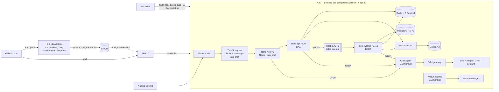
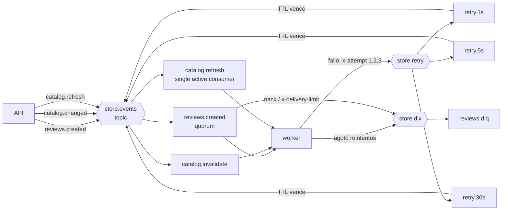

# Implementación del plan de migración de plataforma

Este documento describe cómo se implementó en este repositorio el
[PLATFORM-MIGRATION-PLAN.md](https://github.com/tuxtter/distributedsystems/blob/main/PLATFORM-MIGRATION-PLAN.md):
pasar de la pila de Docker Compose en un solo host a un clúster **K3s con un nodo en cada computadora del equipo** (equipo de 2: 1 server + 1 agent; el diseño escala a 3+ servidores),
con **Terraform**, **FluxCD**, **GitHub Actions**, **RabbitMQ**,
**OpenTelemetry + Grafana LGTM** y **Wazuh**. Docker Compose se queda como entorno de
desarrollo local.

- Estado de cada punto del plan y archivo que lo implementa: [PLAN-ESTADO.md](PLAN-ESTADO.md)
- Cómo ejecutar las pruebas y resultados medidos: [PRUEBAS.md](PRUEBAS.md#5-resultados)
- Capturas de la ejecución real: [evidencias/](evidencias/README.md)
- Procedimientos de operación: [runbooks/](runbooks/)

---

## 1. Arquitectura final



### Namespaces y aislamiento

| Namespace | Contenido | Pod Security | NetworkPolicy |
|-----------|-----------|--------------|---------------|
| `store` | web, API, worker, Job de migraciones | `restricted` | default-deny entrada **y** salida; Traefik→web→API→datos |
| `store-data` | Galera+MaxScale, MongoDB, Redis+Sentinel, RabbitMQ, respaldos | `baseline` | default-deny de entrada; solo app, operadores, KEDA y observabilidad |
| `observability` | OTel agent/gateway, LGTM | `privileged` (lee logs del nodo) | — |
| `wazuh` | Wazuh manager/indexer/dashboard y agentes | `privileged` | — |
| `flux-system`, `*-operator`, `cert-manager`, `kyverno`, `keda`, `chaos-mesh`, `metallb-system` | plataforma | — | — |

### Qué reemplaza a qué

| Compose (antes) | K3s (ahora) |
|-----------------|-------------|
| `presentation-lb-*` + Keepalived (VIP 172.30.0.250) | MetalLB (VIP en la LAN) + Traefik Ingress |
| `application-lb-*` + Keepalived (VIP 172.31.0.250) | `Service` `store-api` (kube-proxy) |
| `db-lb` (HAProxy TCP) | **MaxScale** `readwritesplit` (consciente de Galera, failover) |
| `galera1..3` (bitnami) | `MariaDB` CR con `galera.enabled` (mariadb-operator) |
| `mongodb..3` + `mongo-init` | `MongoDBCommunity` CR (3 miembros, SCRAM) |
| `redis`, `redis2`, `sentinel1..3` | `RedisReplication` (3) + `RedisSentinel` (3), con contraseña |
| Escritura síncrona de reseñas | RabbitMQ + `store-worker` |
| `X-Request-Trace` + UI propia | OpenTelemetry (navegador → Nginx → API → RabbitMQ → worker) |
| Nagios interno | Grafana/Mimir para métricas internas + Nagios **externo** de caja negra |
| Contraseñas en `.env` | Secrets cifrados con SOPS (age) descifrados por Flux |

HAProxy y Keepalived ya no están en la ruta de producción; solo siguen en
`docker-compose.yml` para desarrollo local (Fase 8, último punto).

---

## 2. Fase 0 — Prerrequisitos de las imágenes

**Imágenes versionadas, sin root y mínimas**

| Imagen | Dockerfile | Base | Usuario | Puerto |
|--------|-----------|------|---------|--------|
| `store-api` | [application/Dockerfile](../application/Dockerfile) | `node:22.23.5-alpine3.24` (multi-stage, `npm ci --omit=dev`) | 1000 | 8080 |
| `store-worker` | [worker/Dockerfile](../worker/Dockerfile) | igual | 1000 | 8081 (sondas) |
| `store-web` | [web/Dockerfile](../web/Dockerfile) | `nginx:1.30.8-alpine-otel` | 101 | 8080 |

Las tres funcionan con `readOnlyRootFilesystem: true` (Nginx escribe sus temporales en
`/tmp` y genera `conf.d` en un `emptyDir`). El contexto de construcción es la raíz del
repositorio porque las imágenes incluyen `shared/`, `messaging/` y
`database/migrations/`.

**Sondas de salud** (API, [application/app.js](../application/app.js)):

- `GET /healthz` — *liveness*: el proceso responde (no toca dependencias).
- `GET /readyz` — *readiness*: MariaDB, MongoDB, Redis y RabbitMQ con timeout de 2 s.
  Si RabbitMQ cae y el modo síncrono de respaldo está activo, la API sigue *ready*
  (no se saca a todos los pods del Service por una dependencia opcional).
  Durante el apagado (`SIGTERM`) devuelve 503 para que el endpoint salga del Service
  antes de cerrar conexiones.
- `GET /health` se conserva como alias de `/readyz` (lo usa `resilience-lab`).

**Configuración 12-factor**: todo sale de variables de entorno
([shared/config.js](../shared/config.js)). No hay hosts fijos en el código: `DB_HOST`,
`MONGO_URL`/`MONGO_HOSTS`, `REDIS_SENTINELS`, `RABBITMQ_URL`, `OTEL_*`, etc. En
Kubernetes vienen del ConfigMap `store-config` y de Secrets.

**Registro y etiquetas** (GHCR, `ghcr.io/<owner>/store-{api,web,worker}`):

| Evento | Etiquetas |
|--------|-----------|
| push a `main` | `sha-<7>` y `main-<run>-<sha7>` (la que sigue Flux en dev) |
| tag `vX.Y.Z` | `X.Y.Z`, `X.Y`, `sha-<7>` |

---

## 3. Fase 1 — Infraestructura como código (Terraform)

Directorio [infra/terraform/](../infra/terraform/):

```text
modules/network        /etc/hosts, módulos/sysctl de Kubernetes, ufw abierto solo a la LAN
modules/storage        directorio de datos de local-path en cada nodo
modules/k3s-nodes      K3s HA: nodo 1 con cluster-init (etcd embebido), nodos 2..n se unen
modules/flux-bootstrap deploy key, flux_bootstrap_git, Secret sops-age, notificaciones
envs/dev, envs/prod    raíz de cada entorno (tfvars y backend separados)
```

- **Nodos**: un nodo K3s por computadora del equipo, con `role = "server"` (plano de control +
  etcd + cargas) o `role = "agent"` (solo cargas). El equipo es de **2 computadoras**, así
  que el clúster es **1 server + 1 agent**: con 2 servidores etcd perdería el quórum si
  cae cualquiera de los dos, lo que sería peor que tener uno. La validación exige un
  número impar de servidores, y con 3 computadoras se usan 3 servidores para tener HA del
  plano de control sin cambiar nada más ([ver sección 12](#12-limitaciones-y-decisiones)).
- **Red entre nodos**: `overlay = "lan"` (Linux en la misma LAN, con MetalLB) o
  `overlay = "tailscale"`. Este segundo modo es el del equipo: las computadoras usan
  Windows + WSL y una tiene Windows 10, sin red "mirrored". Con Tailscale, K3s usa
  `flannel-iface: tailscale0` y el Ingress se publica con servicelb en lugar de MetalLB.
  Guía: [CLUSTER-EQUIPO.md](CLUSTER-EQUIPO.md).
- **K3s** ([config.yaml.tftpl](../infra/terraform/modules/k3s-nodes/templates/config.yaml.tftpl)):
  versión fija, `servicelb` deshabilitado (lo reemplaza MetalLB), cifrado de Secrets en
  etcd (`secrets-encryption`) y **auditoría de la API** con una
  [política](../infra/terraform/modules/k3s-nodes/templates/audit-policy.yaml) cuyos logs
  lee Wazuh.
- **Estado remoto con bloqueo**: backend `s3` (MinIO de la LAN o cualquier S3) con
  `use_lockfile = true` (archivo `.tflock`, sin DynamoDB). Compatible con OpenTofu ≥ 1.10.
  Cada entorno tiene su `backend.hcl` y su `terraform.tfvars`.
- **Bootstrap de Flux** con el provider `fluxcd/flux`: Terraform solo instala Flux y crea
  el Secret `sops-age`; todo lo demás lo despliega Flux desde Git.
- **Aplicación en dos pasos** (el provider de Flux necesita el kubeconfig que genera K3s):
  `terraform apply -target=module.k3s` y luego `terraform apply`.
- **CI**: `terraform fmt -check`, `validate`, `tflint` y `checkov` (ver Fase 4).
  `terraform validate` pasa en `dev` y `prod`.
- **Alternativa en una sola computadora**: [scripts/local-cluster.sh](../scripts/local-cluster.sh)
  crea el mismo clúster (1 server + 1 agent; `SERVERS=3` para HA) con **k3d**, donde cada
  nodo K3s es un contenedor Docker. Es la alternativa a `minikube --nodes 3` del plan. Con
  `gitops`, Flux lo reconcilia desde GitHub igual que al clúster real. Es la que usó el
  equipo cuando se descompuso la segunda computadora (ver
  [CLUSTER-EQUIPO.md](CLUSTER-EQUIPO.md#plan-b-una-sola-computadora)).

---

## 4. Fase 2 — Workloads en Kubernetes

[deploy/base/](../deploy/base/) (Kustomize) + overlays
[dev](../deploy/overlays/dev/kustomization.yaml) / [prod](../deploy/overlays/prod/kustomization.yaml):

| Recurso | Detalle |
|---------|---------|
| Deployments | `store-web` (3), `store-api` (3), `store-worker` (2); `maxUnavailable: 0` |
| Probes | startup/liveness `/healthz`, readiness `/readyz` (API), `/healthz` (web), `/readyz` del worker = conectado a RabbitMQ |
| Recursos | requests y limits en todos los contenedores |
| HPA | API 3→9 y web 3→6 al 70 % de CPU; worker 2→6 (dev) o **KEDA** por profundidad de cola (prod) |
| PDB | `minAvailable: 2` web/API, 1 worker |
| Topología | `topologySpreadConstraints` por `kubernetes.io/hostname` (una réplica por nodo) |
| Seguridad del pod | no root, `seccomp: RuntimeDefault`, `drop: [ALL]`, sin token de ServiceAccount |
| Job `store-init` | migraciones de MariaDB e índices de MongoDB; Flux lo recrea al cambiar la imagen |
| Ingress | Traefik, TLS de cert-manager, `rate-limit` (100 req/s, ráfaga 200 por IP), cabeceras de seguridad |
| NetworkPolicies | [base/networkpolicies.yaml](../deploy/base/networkpolicies.yaml), [data/networkpolicies.yaml](../deploy/data/networkpolicies.yaml) |

**Capa de datos con operadores** ([deploy/data/](../deploy/data/)):

- **MariaDB Galera** (mariadb-operator 26.10.2): 3 réplicas con antiafinidad, PDB
  `maxUnavailable: 1`, y **MaxScale** (2 réplicas) con `readwritesplit` y monitor
  cooperativo. Usuarios con privilegio mínimo: `store_app` (`SELECT, UPDATE`) y
  `store_migrator` (DDL solo en `store`). Resuelve el punto 3 del ToDo.
- **MongoDB** (Community Operator 0.13.0): replica set de 3, SCRAM, usuario de aplicación
  `store-reviews-app` con `readWrite` solo en `store_reviews`; el operador publica su
  cadena de conexión en su propio namespace. La API y el worker arman la conexión por partes
  (`MONGO_HOSTS`, `MONGO_REPLICA_SET`, `MONGO_USER`) con la contraseña de `store-app-secrets`.
  Al principio se publicaba la cadena en `store` con `connectionStringSecretNamespace`, pero
  ese Secret lleva un *ownerReference* entre namespaces y el recolector de basura de
  Kubernetes lo borraba en bucle; lo detectó la prueba de pérdida de nodo.
- **Redis** (OT redis-operator 0.27.0): 1 primario + 2 réplicas y 3 Sentinels, con
  contraseña. Redis se trata como **caché desechable**.
- Los operadores, MetalLB, cert-manager, Kyverno, KEDA y Chaos Mesh se instalan como
  `HelmRelease` con versiones fijas verificadas en sus repositorios
  ([deploy/platform/operators/](../deploy/platform/operators/)).

---

## 5. Fase 3 — Colas (RabbitMQ)

- **Clúster**: `RabbitmqCluster` de 3 réplicas, `pause_minority`, cola por defecto
  `quorum`, volúmenes persistentes y credenciales propias vía
  `secretBackend.externalSecret` ([deploy/queues/rabbitmq.yaml](../deploy/queues/rabbitmq.yaml)).
- **Topología versionada** en [messaging/topology.json](../messaging/topology.json); la API
  y el worker la declaran de forma idempotente al conectarse
  ([shared/topology.js](../shared/topology.js)). **Esquemas** de mensajes en
  [messaging/schemas/](../messaging/schemas/) (JSON Schema).



### Casos de uso implementados

1. **Escritura asíncrona de reseñas** — `POST /products/{sku}/reviews` valida, verifica el
   producto en MariaDB y publica `review.created` con *publisher confirms*. Responde
   **202 Accepted**. El worker inserta en MongoDB.
   - **Idempotencia**: el cliente puede mandar `Idempotency-Key` (si no, la API genera un
     UUID); se usa como `messageId` y como índice único parcial en MongoDB. Una entrega
     repetida produce `E11000` y el worker simplemente confirma (`ack`).
   - **Reintentos con backoff**: 1 s → 5 s → 30 s mediante colas con TTL que regresan el
     mensaje a `reviews.created`; luego `reviews.dlq`. Los mensajes malformados van
     directo a la DLQ (`nack` sin requeue → DLX).
   - **Degradación**: si RabbitMQ no está disponible la API escribe directo en MongoDB
     (201) con la misma llave de idempotencia (`REVIEWS_SYNC_FALLBACK=true`).
2. **Invalidación de caché** — `PUT /products/{sku}/price` (requiere
   `Authorization: Bearer $API_ADMIN_TOKEN`) actualiza MariaDB y publica
   `catalog.changed`; el worker borra **solo** las llaves `store:products:*` (SCAN, nunca
   FLUSHDB) y pide un `catalog.refresh`.
3. **Calentamiento de caché / protección contra estampida** — ante un *cache miss*, un
   solo pod gana un candado en Redis (`SET NX PX`) y publica `catalog.refresh`; la cola
   tiene `x-single-active-consumer`, así que **un único worker** consulta MariaDB y
   repuebla la caché. Las demás peticiones esperan hasta 1.5 s a que aparezca y, si no,
   leen MariaDB y escriben con `NX`. Una prueba unitaria verifica que 3 *misses*
   concurrentes producen 1 mensaje y 0 consultas a MariaDB.

**Métricas de colas y alertas**: el worker publica `store_queue_messages` y
`store_queue_consumers` por cola (profundidad y *consumer lag*) y
`store_messages_processed_total{outcome}`; las alertas `StoreReviewsQueueBacklog`,
`StoreReviewsNoConsumers` y `StoreDeadLetterQueueNotEmpty` están en
[alerts/rules.yaml](../deploy/platform/observability/alerts/rules.yaml).

**Autoescalado por cola**: en prod, `ScaledObject` de KEDA (2→10 workers, 50 mensajes por
réplica) en [components/keda-worker](../deploy/components/keda-worker/).

En Docker Compose se agregaron `rabbitmq` (un nodo, consola en `127.0.0.1:15672`) y
`worker` (2 réplicas).

---

## 6. Fase 4 — CI/CD con GitHub Actions

| Workflow | Disparador | Qué hace |
|----------|-----------|----------|
| [ci.yml](../.github/workflows/ci.yml) | PR y push a main | ESLint + 34 pruebas unitarias (`node:test`); build de las 3 imágenes + **Trivy** (HIGH/CRITICAL con parche); `docker compose config`; `terraform fmt/validate`, **tflint**, **checkov**; `kustomize build` + **kubeconform** con esquemas de CRDs |
| [release.yml](../.github/workflows/release.yml) | push a main, tags `v*` | push a GHCR, **SBOM** SPDX + provenance, firma **cosign keyless** (OIDC) y atestación del SBOM; en tags abre un **PR hacia `release`** con la nueva versión |
| [terraform.yml](../.github/workflows/terraform.yml) | cambios en `infra/terraform` | `plan` comentado en el PR; `apply` solo desde `main` en el environment `production` (aprobación manual). Corre en un runner *self-hosted* de la LAN porque los nodos son computadoras del equipo; está desactivado hasta crear la variable `TF_SELF_HOSTED_RUNNER=true` |
| [dependabot.yml](../.github/dependabot.yml) | semanal | npm, Dockerfiles, Actions y providers de Terraform |

**Imágenes mínimas y escaneadas**: la imagen final de la API y del worker no incluye
`npm`, `npx` ni `corepack`; solo se usan para instalar dependencias en la etapa de
construcción. El primer escaneo de Trivy en CI encontró CVEs HIGH en paquetes internos de
npm (brace-expansion, pacote, sigstore, picomatch, ip-address); al quitarlo, las tres
imágenes quedan con 0 vulnerabilidades HIGH/CRITICAL con parche disponible. Las
dependencias de la propia aplicación no tenían ninguna.

**Sin credenciales de larga duración**: GHCR usa el `GITHUB_TOKEN` efímero y cosign usa
la identidad OIDC del workflow. Los únicos secretos del repositorio son los del estado de
Terraform y el runner de la LAN. Jenkins queda fuera de alcance, como indica el plan.

---

## 7. Fase 5 — GitOps con FluxCD

Puntos de entrada [clusters/dev](../clusters/dev/) y [clusters/prod](../clusters/prod/)
([README](../clusters/README.md)).

| Caso de uso | Implementación |
|-------------|----------------|
| Bootstrap del clúster | `clusters/<env>/` contiene las `Kustomization` de Flux; Terraform solo ejecuta `flux_bootstrap_git` |
| Promoción entre entornos | dev sigue `main`; prod sigue la rama `release`. `release.yml` abre el PR de promoción y su aprobación es la puerta |
| Image automation | `ImageRepository` + `ImagePolicy` (orden numérico de `main-<run>-<sha>`) + `ImageUpdateAutomation` que hace commit en `deploy/overlays/dev` (marcadores `$imagepolicy`) |
| Orden de dependencias | `platform-sources → platform-operators → platform-config → secrets → data → queues → apps`, y `observability` antes de `apps` |
| Drift y rollback | `prune: true` y reconciliación periódica revierten cambios manuales; rollback = `git revert` (ver [runbooks/rollback.md](runbooks/rollback.md)). `data` y `queues` usan `prune: false` para no borrar bases por error |
| Secretos | SOPS + age ([.sops.yaml](../.sops.yaml), [scripts/generate-secrets.sh](../scripts/generate-secrets.sh)); Kustomization `secrets` con `decryption.provider: sops` |
| Notificaciones | `Provider`/`Alert` a GitHub commit status y Slack ([notifications.yaml](../clusters/dev/notifications.yaml)) |

---

## 8. Fase 6 — Observabilidad (OpenTelemetry + LGTM) — opcional

> **Opcional por consumo de RAM.** El maestro indicó que este paso (el 5 del *Suggested
> order* del plan) es opcional. Todo está implementado, pero la Kustomization de Flux
> `observability` viene **suspendida** (`suspend: true`) y el clúster local no la instala
> salvo con `OBSERVABILITY=1`. Así se ahorra RAM: la de dev pide ≈0.9 GB y usa 1–2 GB
> reales con `otel-lgtm`; la de prod (Loki + Tempo + Mimir + Grafana) varios GB más.
> Sin ella, la aplicación funciona igual: `apps` ya no depende de `observability`, y el
> SDK de OpenTelemetry descarta lo que no puede enviar.
>
> Encender: `flux resume kustomization observability`. Apagar y liberar la memoria:
> `flux suspend kustomization observability && kubectl delete namespace observability`.
> Al borrar el namespace también se borra el Secret `grafana-admin`; Flux lo vuelve a crear
> al reconciliar la Kustomization `secrets`.

**Instrumentación**

- **API y worker**: `@opentelemetry/auto-instrumentations-node` cargado con
  `node --import ./telemetry.js` (con el *hook* ESM). Instrumenta HTTP, mysql2, MongoDB,
  Redis y **amqplib**; esta última propaga el contexto en los headers de los mensajes,
  así que la petición HTTP y el procesamiento en el worker quedan **en la misma traza**.
  Métricas propias: `store.cache.requests{result}`, `store.reviews.submitted{mode}`,
  `store.messages.processed{queue,outcome}`, `store.queue.messages/consumers`,
  `store.galera.cluster_size`. Logs JSON con `trace_id`/`span_id`.
- **Nginx**: imagen oficial `-otel` con `ngx_otel_module`, `otel_trace_context propagate`
  (continúa el `traceparent` del navegador) y logs JSON con `$otel_trace_id`.
- **Navegador** ([web/catalog.js](../web/catalog.js)): genera un `traceparent` W3C en cada
  petición, mide la duración y exporta un span `CLIENT` en formato **OTLP/HTTP JSON** a
  `/otel/v1/traces` (Nginx lo reenvía al Collector, mismo origen, sin CORS). La interfaz
  muestra el *trace ID* con enlace a Grafana Tempo y reemplaza la lista de saltos de
  `X-Request-Trace` (que solo se mantiene en Compose con `LEGACY_TRACE_HEADER=true`).
  *Decisión*: se exporta el span con un exportador OTLP propio de ~40 líneas en lugar de
  `@opentelemetry/sdk-trace-web`, porque la tienda es HTML estático sin bundler; el
  formato y la propagación son los mismos.

**Recolección**

- **Agente** (DaemonSet, [base/otel-agent.yaml](../deploy/platform/observability/base/otel-agent.yaml)):
  OTLP, `filelog` de `/var/log/pods`, `kubeletstats`, `hostmetrics`, procesador
  `k8sattributes`. El Service usa `internalTrafficPolicy: Local` (cada pod envía al
  agente de su nodo).
- **Gateway**: en **prod** un Deployment de 2 réplicas que exporta trazas → Tempo,
  métricas → Mimir (OTLP) y logs → Loki (OTLP), y además lee las métricas nativas de
  RabbitMQ. En **dev** el gateway es `grafana/otel-lgtm` (todo en un pod) para que quepa
  en una laptop.
- **Backends prod** (Helm, gestionados por Flux): Loki 6.55.0, Tempo 1.24.4,
  Mimir 5.8.1, Grafana 8.15.0, con datasources enlazados (log → traza → métricas).

**Dashboards y alertas como código**

- [store-overview.json](../deploy/platform/observability/dashboards/store-overview.json):
  RED por servicio, p50/p95/p99, cache hit rate, profundidad y consumidores de RabbitMQ,
  `wsrep_cluster_size` de Galera, CPU/memoria por pod y saturación de nodos.
- **SLOs** ([rules.yaml](../deploy/platform/observability/alerts/rules.yaml)):
  disponibilidad 99.5 % (presupuesto de error 0.5 %) y p95 < 300 ms. Alertas de
  **burn rate** multiventana (14.4× en 1 h y 5 min; 6× en 6 h y 30 min). Las carga un Job
  con `mimirtool`, junto con Alertmanager → Slack.
- **Nagios externo** ([nagios/external-k3s.cfg](../nagios/external-k3s.cfg)): solo caja
  negra desde fuera del clúster (HTTP por el Ingress, vencimiento del certificado TLS,
  `/readyz` de la API de Kubernetes en cada nodo). No duplica alertas internas.

---

## 9. Fase 7 — Seguridad

| Control | Implementación |
|---------|----------------|
| Wazuh manager/indexer/dashboard | [bootstrap.sh](../deploy/platform/wazuh/bootstrap.sh) instala `wazuh-kubernetes` v4.14.10 (los certificados se generan en el momento y no se versionan) |
| Agentes Wazuh | DaemonSet en cada nodo ([agent-daemonset.yaml](../deploy/platform/wazuh/agent-daemonset.yaml)) con [ossec.conf](../deploy/platform/wazuh/ossec.conf): **FIM** de `/etc/rancher`, manifiestos y TLS de K3s, binarios; **rootcheck**; **syscollector** (detección de vulnerabilidades en el manager); **SCA/CIS**; ingesta del **audit log de K3s**; *active response* deshabilitado (conservador) |
| Pod Security Admission | `restricted` en `store`, `baseline` en `store-data` |
| Contenedores | no root, raíz de solo lectura, sin capacidades, seccomp |
| RBAC mínimo | ServiceAccounts sin token montado; el único rol de clúster propio es el de lectura del OTel agent |
| CIS benchmark | [kube-bench-job.yaml](../deploy/platform/security/kube-bench-job.yaml) (perfil `k3s-cis-1.8`) |
| TLS en el Ingress | cert-manager con CA propia (`store-ca`); `letsencrypt` listo para dominios públicos |
| Usuarios de BD con privilegio mínimo | MariaDB `store_app` (SELECT/UPDATE), `store_migrator`; MongoDB `readWrite` solo en `store_reviews` (también en Compose); Redis con contraseña |
| Secretos | SOPS/age en Git; Secrets cifrados en etcd (`secrets-encryption`). Resuelve el punto 6 del ToDo |
| Autenticación y rate limiting | Bearer token para el endpoint de administración; `rateLimit` de Traefik en el Ingress |
| Cadena de suministro | Trivy en CI, SBOM, firma cosign y **política Kyverno** `verify-store-images` (Audit en dev, **Enforce** en prod), Dependabot |
| mTLS entre servicios | Opcional en el plan; no implementado (requeriría un service mesh) |

---

## 10. Fase 8 — Corte y validación

- **Ejecución en paralelo y corte gradual**: perfil `cutover` de Compose
  ([haproxy/cutover.cfg](../haproxy/cutover.cfg)) que reparte el tráfico entre la pila de
  Compose y el Ingress de K3s con pesos (`CUTOVER_COMPOSE_WEIGHT` / `CUTOVER_K3S_WEIGHT`).
  Es el equivalente local de los pesos DNS del plan.
- **Caos en Kubernetes**: Chaos Mesh + experimentos
  ([deploy/platform/chaos/experiments/](../deploy/platform/chaos/experiments/)) que portan
  los escenarios de `resilience-lab` (pod de API/web, nodo de Galera, primario de MongoDB,
  Redis, RabbitMQ, latencia de red) y la guía de pérdida de nodo.
- **Respaldos**: `Backup` diario de MariaDB (operador), `mongodump` diario y exportación
  diaria de las definiciones de RabbitMQ ([deploy/data/backups.yaml](../deploy/data/backups.yaml)).
  Restauración en [runbooks/backup-restore.md](runbooks/backup-restore.md).
- **Runbooks**: [despliegue](runbooks/deploy.md), [rollback](runbooks/rollback.md),
  [pérdida de nodo](runbooks/node-loss.md), [acumulación en cola](runbooks/queue-backlog.md),
  [incidente de seguridad](runbooks/security-incident.md),
  [respaldo y restauración](runbooks/backup-restore.md).

---

## 11. Cambios en el código de la aplicación

| Archivo | Cambio |
|---------|--------|
| [application/app.js](../application/app.js) | Manejador HTTP con dependencias inyectadas (se prueba con dobles): `/healthz`, `/readyz`, publicación a RabbitMQ, idempotencia, protección contra estampida, `PUT /products/{sku}/price` |
| [application/index.js](../application/index.js) | Arranque, conexión a RabbitMQ sin bloquear, apagado ordenado |
| [application/migrate.js](../application/migrate.js) + [database/migrations/](../database/migrations/) | Migraciones versionadas con checksum (`schema_migrations`); reemplazan `catalog.sql` |
| [application/init-db.js](../application/init-db.js) | Migraciones con usuario de migración, usuario de aplicación de MongoDB, índice único de idempotencia |
| [worker/](../worker/) | Nuevo servicio consumidor (3 colas), métricas, sondas |
| [shared/](../shared/) | Código sin dependencias de npm usado por API y worker (topología, mensajes, AMQP con reconexión, configuración, logger) |
| [web/](../web/) | Imagen K8s con OTel, UI con trazas W3C y formulario de reseñas |

### Compatibilidad con la pila de Compose

Los endpoints anteriores se conservan (`/`, `/health`, `/products/cheapest`,
`/products/{sku}/reviews`, `POST /cache/clear`). Cambios visibles: `POST` de reseñas
responde **202** (cola) en lugar de 201, la caché usa la llave
`store:products:cheapest:v1`, y la API usa el usuario de aplicación de MongoDB. Para un
`.env` existente, `./levantar.sh` agrega las variables nuevas (`MONGO_APP_*`,
`RABBITMQ_*`, `API_ADMIN_TOKEN`) con contraseñas aleatorias.

---

## 12. Limitaciones y decisiones

- **Qué se verificó y dónde**: la plataforma se desplegó y probó el 2026-11-24 en Docker
  Compose y en un clúster K3s de 1 server + 1 agent sobre k3d, en una sola computadora
  (ver [evidencias/](evidencias/README.md) y [PRUEBAS.md](PRUEBAS.md#5-resultados)): 34
  pruebas unitarias, pruebas funcionales, desempeño, 8 experimentos de caos y pérdida de
  nodo. El despliegue local usa `kubectl apply` en el mismo orden que Flux. El *bootstrap*
  real de Flux desde GitHub, Terraform contra computadoras por SSH y los workflows de
  GitHub Actions quedaron validados estáticamente (`terraform validate`, YAML), pero no
  ejecutados, porque requieren subir el repositorio y una segunda computadora.
- **Observabilidad y Wazuh no se desplegaron en la prueba**: los dos son opcionales por
  memoria (≈6 GB disponibles para WSL). Se activan con `OBSERVABILITY=1` y con
  `deploy/platform/wazuh/bootstrap.sh`.
- **Equipo de 2 computadoras (1 server + 1 agent)**:
  - Si se apaga la computadora **agent**, todo sigue funcionando: el plano de control vive en el server y las réplicas se reprograman.
  - Si se apaga la computadora **server**, el plano de control se detiene: no se programan ni reconcilian pods nuevos. Los pods del agent siguen corriendo, pero sin la mitad de las bases de datos.
  - Galera, MongoDB y RabbitMQ tienen 3 réplicas repartidas 2 + 1 (antiafinidad preferida, no obligatoria). Perder el nodo que tiene **2** réplicas deja a Galera y a las colas quorum sin mayoría hasta que vuelva.
  - La HA completa del plan (tolerar la pérdida de cualquier nodo) requiere 3 computadoras con `role = "server"`; el código ya lo soporta.
- **Recursos**: la plataforma completa necesita ≈10 GB de RAM entre los nodos (Mimir y
  Wazuh son lo más pesado). En dev se usa `otel-lgtm` y Wazuh es opcional.
- **Retry por TTL**: las colas de reintento con TTL fijo por nivel evitan el bloqueo de
  cabeza de cola que tendría un TTL por mensaje.
- **Redis** es caché desechable: no se respalda.
- **mTLS** entre servicios queda fuera (opcional en el plan).
